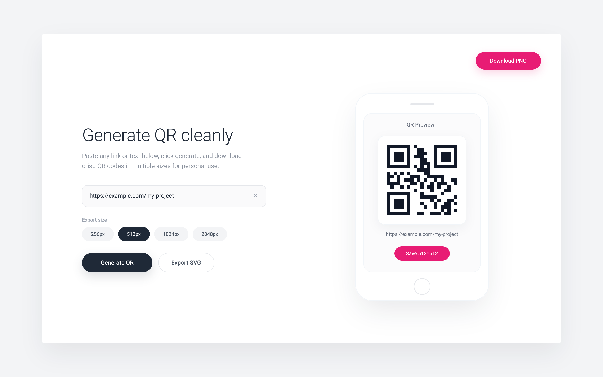

# QR Code Generator

Website **QR Code Generator** pribadi yang ringan, cepat, dan berjalan 100% di sisi browser (*client-side*) menggunakan **React + TypeScript + Vite**. Desain antarmukanya dirancang terlebih dahulu di **FigCraft** dengan tampilan *clean & minimalist*.



## Fitur Utama

- **Input Instan:** Masukkan teks atau tautan (URL) apa saja lalu tekan **Generate QR** (atau tombol `Enter`).
- **Multi-Ukuran PNG:** Unduh hasil QR Code dalam resolusi `256px`, `512px`, `1024px`, hingga `2048px`.
- **Ekspor Vektor SVG:** Tersedia tombol **Export SVG** untuk kebutuhan desain atau cetak resolusi tak terbatas.
- **100% Client-Side:** Seluruh proses pembuatan QR terjadi lokal di browser tanpa mengirim data ke server eksternal.

## Tech Stack

- **UI Design:** [FigCraft](https://figcraft.org) (`design/qr-generator.figcraft`)
- **Frontend:** React 19, TypeScript, Vite
- **QR Engine:** [`qrcode`](https://www.npmjs.com/package/qrcode)
- **Icons:** [`lucide-react`](https://lucide.dev)
- **Testing:** Vitest

## Menjalankan di Lokal

```bash
# Install dependensi
npm install

# Jalankan server development
npm run dev

# Jalankan unit test
npm test

# Build versi produksi
npm run build
```

## Deploy & Buka di GitHub Pages

Repositori ini sudah dilengkapi konfigurasi `base: './'` pada `vite.config.ts` serta workflow otomatis di [`.github/workflows/deploy.yml`](./.github/workflows/deploy.yml).

1. Push repositori ini ke branch `main` di GitHub.
2. Buka tab **Settings → Pages** di repositori GitHub Anda.
3. Pada bagian **Build and deployment → Source**, pilih **GitHub Actions**.
4. Setelah workflow **Deploy to GitHub Pages** selesai berjalan, website dapat langsung diakses melalui URL GitHub Pages Anda:
   ```text
   https://<username>.github.io/<nama-repo>/
   ```
